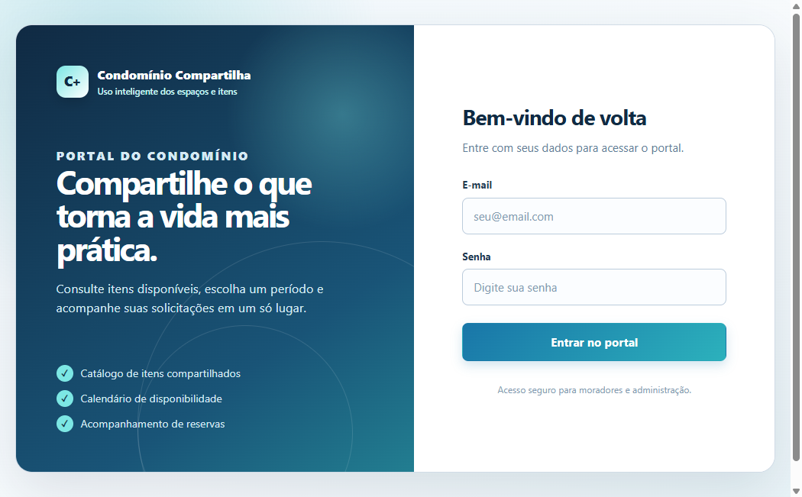
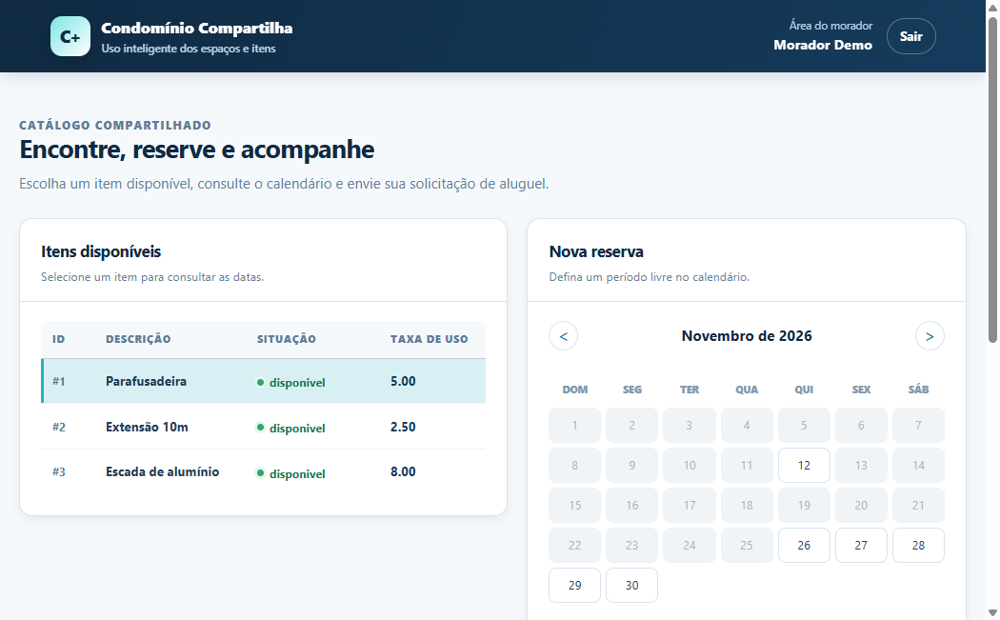
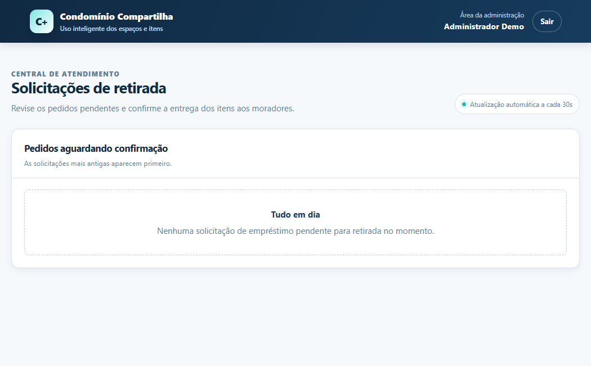

# SenacADS_03_2026 

## Apresentação

Este projeto apresenta um aplicativo com a finalidade de gerenciar o compartilhamento de itens entre moradores de condomínios, elaborado para a disciplina **Projeto Integrador: Desenvolvimento de Sistemas Orientado a dispositivos móveis e baseados na Web**, do curso de **Análise e Desenvolvimento de Sistemas** da Faculdade **SENAC** – modalidade EAD.

## Integrantes do grupo 03 / 2026

- Darcy Augusto Silveira Kutscher
- Fernando da Silva Alves
- Igor Rodrigues Fransa Garcia
- Jeferson dos Santos Silva
- Juraci Araujo Marques
- Vitor Oliveira Torino

## 1. Definição da PoC

O usuário deve ser capaz de consultar a agenda de disponibilidade de uma ferramenta, incluindo os seus dias reservados e disponíveis. O usuário poderá registrar o pedido para empréstimo de uma ferramenta para uma data disponível, mas o sistema deverá impedir o usuário de registrar uma reserva para um dia já reservado por ele mesmo ou por outra pessoa.

**Jornada do morador no teste:**

1. Usuário acessa o sistema
2. Realiza o login
3. Visualiza o catálogo
4. Seleciona um item
5. Consulta o calendário
6. Seleciona data inicial e final
7. Sistema verifica disponibilidade
8. Se a data já estiver reservada:
   - a reserva não continua
   - o usuário seleciona outra data
9. Sistema mostra período (e taxa de uso, quando aplicável)
10. Usuário confirma a solicitação
11. Reserva é registrada
12. Datas ficam bloqueadas no calendário

**Jornada do funcionário do condomínio:**
1. Funcionário acessa o sistema
2. Realiza o login
3. O morador comparece para retirar o item
4. O funcionário verifica no sistema e confirma a existência da reserva
5. Entrega o item ao morador e confirma a entrega no sistema  

## 1.1. Revisitar jornada (evolução da PoC)

**Evolução planejada (ainda não implementada):** o administrador também poderá cancelar reservas com justificativas pré-definidas (ferramenta perdida, danificada, em manutenção), bloquear o item e notificar moradores e síndico:

1. Administrador acessa o sistema
2. Realiza o login
3. Visualiza **Solicitações de retirada**
4. Seleciona a reserva que deseja cancelar
5. Insere a justificativa apropriada
6. Confirma o cancelamento da reserva
7. A reserva permanece visível no histórico com status cancelada (conforme regras implementadas)

## Capturas de tela

As telas principais da aplicação podem ser visualizadas abaixo:

### Login



### Área do morador



### Área da administração



## 2. Preparação do ambiente

### 2.1. Stack

A stack escolhida para este projeto é composta por:

| Tecnologia | Uso |
|------------|-----|
| **Apache** | Servidor web que disponibiliza a aplicação no navegador |
| **PHP** | Back-end, autenticação, consultas e API |
| **HTML/CSS/JavaScript** | Interface do usuário em `frontend/` |
| **MySQL** | Armazenamento das informações da aplicação |
| **Docker** | Containers para subir a aplicação e o banco sem instalar cada serviço à parte |

### 2.2. Ambiente / servidor

Para executar a PoC localmente, o ambiente é composto por:

- Servidor web Apache
- Linguagem PHP
- Banco de dados MySQL
- Estrutura SQL em `backend/database/empCondominio2.sql` (e `backend/database/docker/01-schema.sql` no Docker)
- Interface em `frontend/` e API PHP em `backend/public/`

O ambiente **recomendado** é executado por **containers**, evitando instalação e configuração separada de cada serviço. Também é possível rodar **manualmente** com XAMPP ou PHP + MySQL na máquina (seção 2.4).

#### 2.2.1. Requisitos para reproduzir o ambiente (Docker)

- **Docker Desktop**
  - [Windows](https://docs.docker.com/desktop/setup/install/windows-install/)
  - [macOS](https://docs.docker.com/desktop/setup/install/mac-install/)
  - [Linux (Desktop)](https://docs.docker.com/desktop/setup/install/linux/)
  - No Linux também é possível usar apenas o [Docker Engine](https://docs.docker.com/engine/install/)
- **Navegador** e **terminal**
- **Arquivos do projeto** clonados ou extraídos em uma pasta à sua escolha
- **Porta 8080** disponível (mapeada no `docker-compose.yml`)
- **Internet** na primeira execução (download das imagens PHP e MySQL)

Mantenha a estrutura de pastas como no repositório após o clone.

#### 2.2.2. Inicializando o ambiente (Docker)

Abra o terminal no diretório raiz do projeto (onde está o arquivo `docker-compose.yml`).

Antes de iniciar os containers, execute:

```bash
docker info
```

Se retornar informações sobre o Docker, o serviço está funcionando. Caso retorne erro, abra o Docker Desktop e aguarde a inicialização.

Na **primeira execução**:

```bash
docker compose up -d --build
```

A flag `-d` executa em segundo plano; omita-a para acompanhar os logs no terminal (`docker compose up --build`).

A primeira execução pode demorar alguns minutos, pois as imagens do PHP e do MySQL precisam ser baixadas.

Para acessar a aplicação, abra o navegador em:

**http://localhost:8080**

Na primeira subida, o MySQL aplica o schema e o container web cria **usuários e itens de demonstração**:

| E-mail | Perfil | Senha |
|--------|--------|-------|
| `admin@condominio.local` | administrador | `Senha123` |
| `morador@condominio.local` | morador (`usuario`) | `Senha123` |

Realize os testes na aplicação conforme a jornada da PoC (seção 1).

Para parar os containers:

```bash
docker compose down
```

Para apagar o volume do MySQL e recomeçar do zero:

```bash
docker compose down -v
```

Arquivos relacionados: `Dockerfile`, `docker-compose.yml`, `docker/entrypoint.sh`, `docker/frontend-backend.conf`, `backend/scripts/seed-database.php`.

### 2.3. Estrutura do repositório

```
SenacADS_03_2026/
├── frontend/
│   ├── index.html          # Redireciona para o login
│   ├── auth/login.html
│   ├── usuario/locacao.html
│   ├── admin/retira.html
│   └── assets/
│       ├── css/
│       ├── js/
│       └── screenshots/
├── backend/
│   ├── config/conexao.php
│   ├── database/
│   │   ├── empCondominio2.sql
│   │   └── docker/
│   ├── public/
│   │   ├── auth/
│   │   ├── usuario/
│   │   ├── admin/
│   │   └── bootstrap.php
│   └── scripts/
├── docker/
├── Dockerfile
└── docker-compose.yml
```

### 2.4. Execução manual (XAMPP / PHP local)

1. Importe `backend/database/empCondominio2.sql` no MySQL.
2. Ajuste credenciais em `backend/config/conexao.php` se necessário (também há suporte a `DB_HOST`, `DB_NAME`, `DB_USER`, `DB_PASS` por variáveis de ambiente).
3. Aponte o Apache (ex.: XAMPP) para a pasta `frontend` deste projeto e configure o alias `/api/` para `backend/public/` usando `docker/frontend-backend.conf` como referência.
4. Acesse `http://localhost/.../index.html`.

O script SQL **não inclui dados de exemplo**. Crie usuários na tabela `Usuario` com `senha_hash` gerado por `password_hash()` no PHP. No Docker, o seed é automático (tabela acima).

### 2.5. Perfis de acesso

| `nivel_acesso`   | Após o login           |
|------------------|------------------------|
| `administrador`  | `frontend/admin/retira.html`     |
| `usuario`        | `frontend/usuario/locacao.html`  |

## 3. Autoria e evolução do repositório

O **código da aplicação** (lógica PHP, telas, consultas ao banco e script SQL do domínio) foi desenvolvido por **Juraci Araujo Marques** e **Fernando da Silva Alves**.

| Juraci e Fernando | Organização do repositório |
|-------------------|----------------------------|
| Conexão PDO (`pi_conexao.php`) | `backend/config/conexao.php` |
| Login (`pi_login.php`) | `backend/public/auth/login.php` — mesma lógica; resposta consumida por `frontend/auth/login.html` |
| Locação (`pi_locacao.php`) | `backend/public/usuario/locacao.php` — mesma lógica; interface em `frontend/usuario/locacao.html` |
| Retirada admin (`pi_retira.php`) | `backend/public/admin/retira.php` — mesma lógica; interface em `frontend/admin/retira.html` |
| `backend/database/empCondominio2.sql` | Correção da coluna `id_responsavel` em `Emprestimo` |
| — | `backend/public/auth/logout.php`, `frontend/index.html`, Docker, seed de demo, este README |

Antes da reorganização, os arquivos `pi_*.php` ficavam na **raiz** do projeto; não havia `README.md` e `pi_logout.php` era citado nas telas, mas não existia no repositório.

Nenhuma regra de negócio nova foi introduzida na reorganização — estrutura de pastas, encerramento de sessão, documentação e ambiente Docker.
